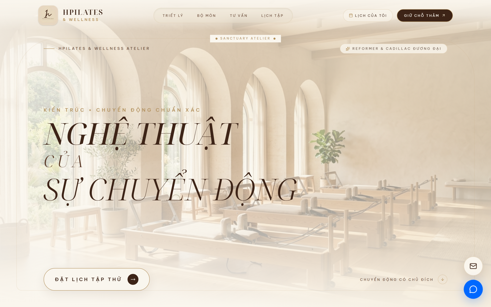
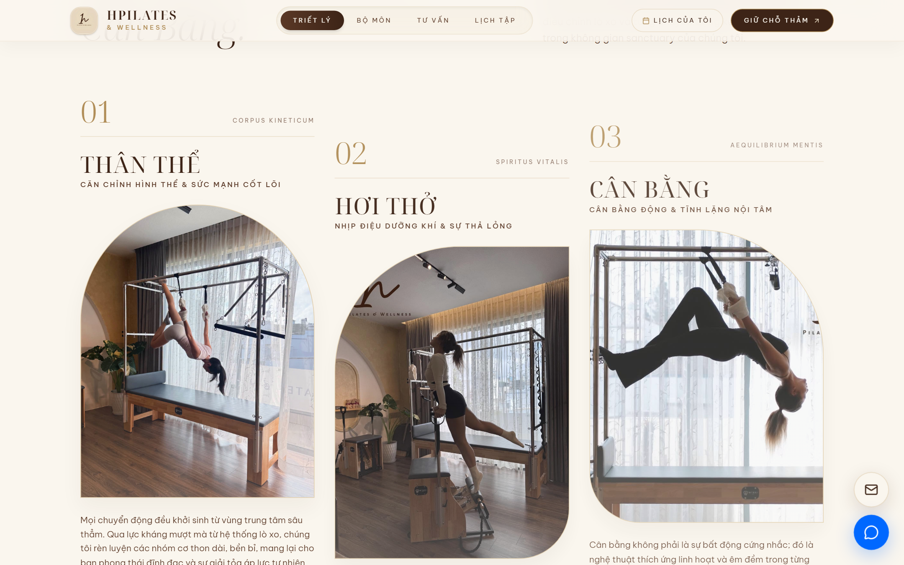
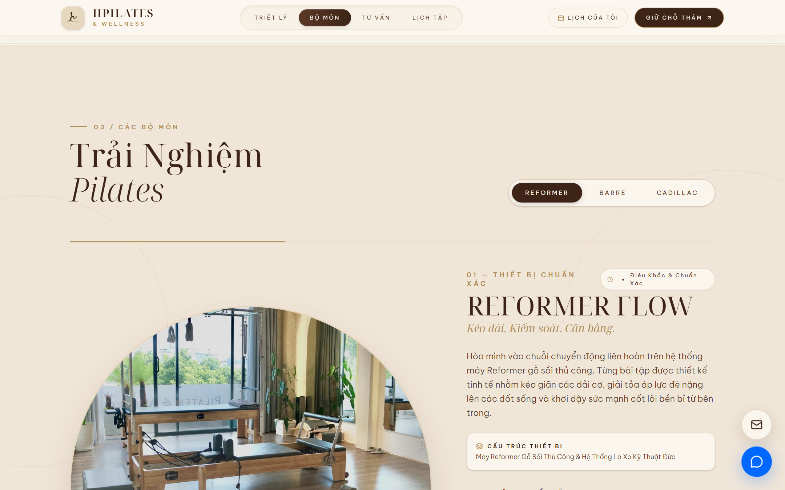
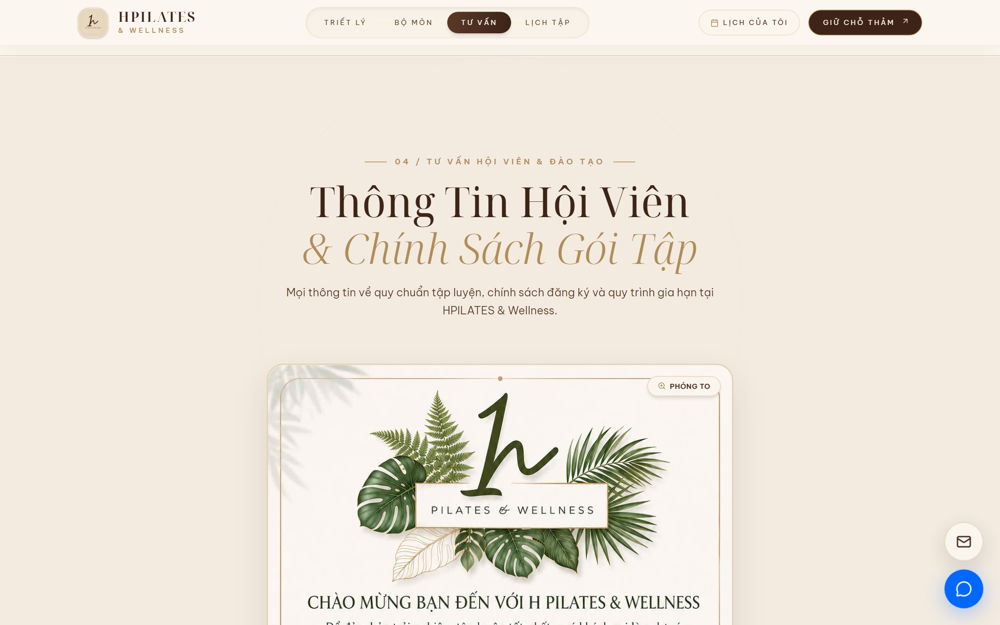
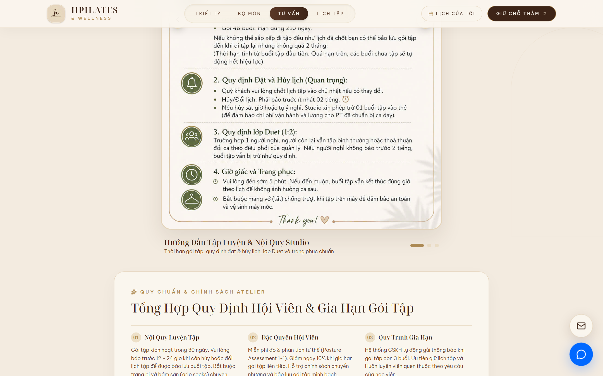
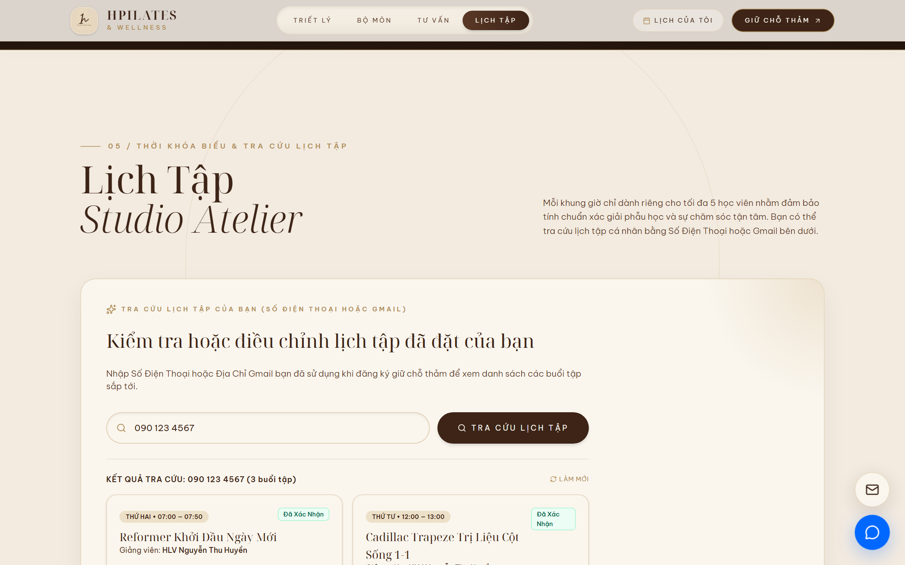
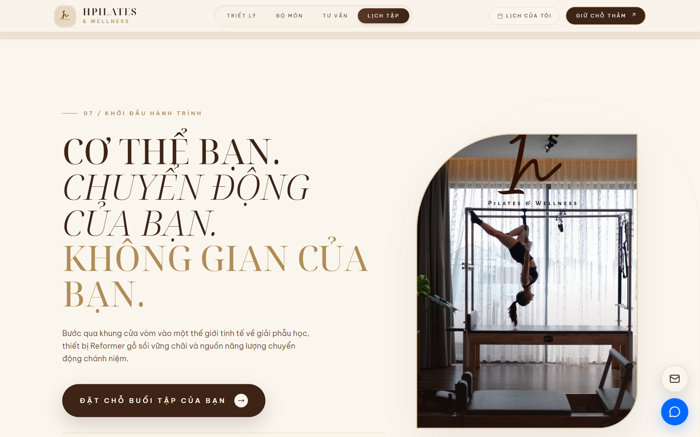
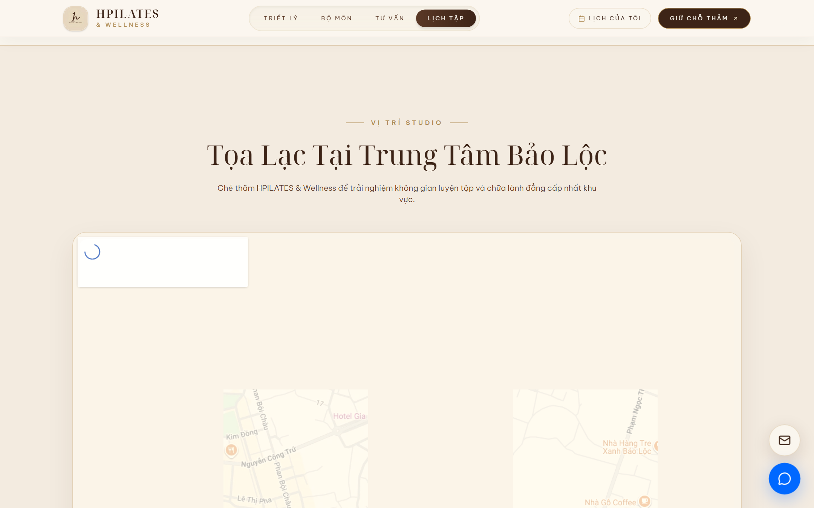
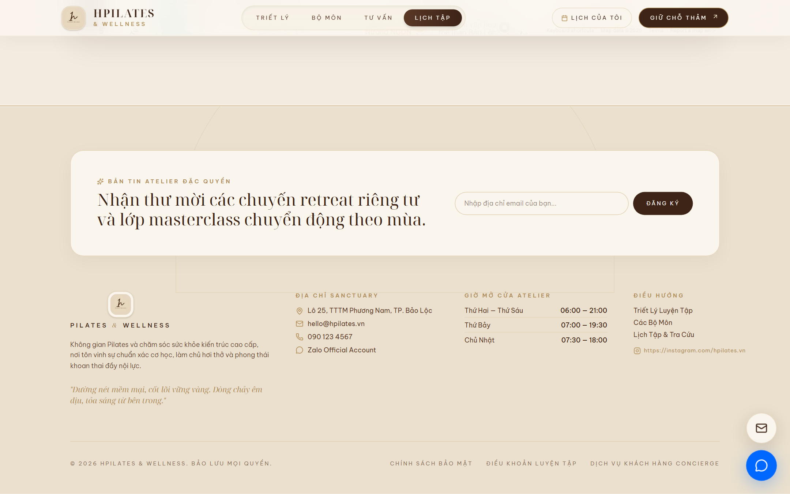

<div align="center">

# 🌿 HPILATES & WELLNESS — ATELIER
### *Nghệ Thuật Của Sự Chuyển Động*

[](https://react.dev/)
[](https://www.typescriptlang.org/)
[](https://vitejs.dev/)
[](https://tailwindcss.com/)
[](https://motion.dev/)
[](https://developer.mozilla.org/en-US/docs/Web/API/Web_Audio_API)

<br/>

**HPILATES & Wellness** là ứng dụng web trải nghiệm phòng tập Pilates cao cấp phong cách **Luxury Boutique Sanctuary Atelier** tọa lạc tại trung tâm TP. Bảo Lộc, Lâm Đồng. Website mang ngôn ngữ thiết kế **Architectural Curves (Đường cong vòm kiến trúc)**, bảng màu tự nhiên thanh lịch (**Ivory • Sand • Coffee • Champagne Gold**), chuyển động mượt mà và hệ thống âm thanh tần số chữa lành **432 Hz Solfeggio** độc bản.

<br/>



</div>

---

## 📑 Mục Lục

1. [Tổng Quan Dự Án](#-tổng-quan-dự-án)
2. [Bộ Sưu Tập Giao Diện Người Dùng (UI Showcase)](#-bộ-sưu-tập-giao-diện-người-dùng-ui-showcase)
3. [Tính Năng Nổi Bật](#-tính-năng-nổi-bật)
4. [Công Nghệ Sử Dụng (Tech Stack)](#-công-nghệ-sử-dụng-tech-stack)
5. [Hướng Dẫn Cài Đặt & Chạy Ứng Dụng (Installation)](#-hướng-dẫn-cài-đặt--chạy-ứng-dụng-installation)
6. [Cấu Trúc Thư Mục (Project Structure)](#-cấu-trúc-thư-mục-project-structure)
7. [Cấu Hình & Tùy Biến (Customization)](#-cấu-hình--tùy-biến-customization)
8. [Thông Tin Studio & Bản Quyền](#-thông-tin-studio--bản-quyền)

---

## 🌟 Tổng Quan Dự Án

* **Thương hiệu**: HPILATES & Wellness Atelier
* **Slogan**: *"Nghệ Thuật Của Sự Chuyển Động"*
* **Địa điểm**: Lô 25, TTTM Phương Nam, TP. Bảo Lộc, Tỉnh Lâm Đồng
* **Đối tượng**: Hội viên tập luyện cá nhân (1:1, Duet 1:2), học viên theo nhóm nhỏ (tối đa 5 thảm/lớp), phụ nữ mang thai (Prenatal), người cần phục hồi cột sống và học viên tham gia các khóa đào tạo HLV Quốc Tế.
* **Đặc trưng trải nghiệm**:
  * Giao diện phong cách nghỉ dưỡng sang trọng (Sanctuary Aesthetics).
  * Con trỏ chuột tương tác thời trang (Custom Luxury Magnetic Cursor).
  * Công cụ **Tra cứu lịch tập cá nhân** tức thì qua Số điện thoại hoặc Gmail.
  * Bộ thẻ quy chuẩn hội viên tương tác kèm Lightbox phóng to trực quan.
  * Trình phát âm thanh tần số sóng não 432 Hz Solfeggio được tổng hợp qua Web Audio API.

---

## 📸 Bộ Sưu Tập Giao Diện Người Dùng (UI Showcase)

### 1. Trang Chủ & Hero Sanctuary Atelier
*Không gian vòm kiến trúc thanh lịch đón chào học viên với thông điệp chuyển động có chủ đích và nút đặt lịch trực tiếp.*


---

### 2. Triết Lý 3 Trụ Cột: Thân Thể • Hơi Thở • Cân Bằng
*Trình bày triết lý vận động chánh niệm cùng hình ảnh máy tập Cadillac Trapeze và Wunda Chair tiêu chuẩn quốc tế.*



---

### 3. Trải Nghiệm Các Bộ Môn Pilates Chuyên Nghiệp
*Tab chuyển đổi mượt mà giữa các hệ bài tập: **Reformer Flow** (Gỗ sồi & lò xo Đức), **Barre & Thảm** (Điêu khắc hình thể) và **Cadillac Trapeze** (Trị liệu & Aerial).*


---

### 4. 5 Giá Trị Phục Hồi Sức Khỏe & Căn Chỉnh Cơ Sinh Học
*Thẻ giá trị phục hồi: giải phóng vai gáy, làm phẳng bụng dưới, phục hồi sau sinh, tăng độ dẻo dai và căn chỉnh trục cột sống.*



---

### 5. Tư Vấn Hội Viên, Nội Quy Studio & Chính Sách Gói Tập
*Slider bộ 3 thẻ tư vấn thiết kế sang trọng: Hướng dẫn nội quy, chính sách đăng ký và quy trình gia hạn tự động.*



---

### 6. Bảng Tổng Hợp Quy Định Hội Viên & Đào Tạo Huấn Luyện Viên
*Bảng biểu tóm tắt thời hạn gói tập, quy định bảo lưu, hủy lịch trước 2 tiếng và chương trình cấp chứng chỉ HLV Quốc Tế.*



---

### 7. Cổng Tra Cứu Lịch Tập Cá Nhân (Phone / Gmail / Booking Code)
*Công cụ tra cứu lịch tập cá nhân theo thời gian thực — cho phép học viên kiểm tra danh sách buổi tập đã đặt, giờ học, HLV phụ trách, số thảm và thao tác hủy lịch tự phục vụ.*



---

### 8. Lời Nhắn Từ Học Viên & Tuyên Ngôn Chuyển Động
*Cảm nhận thực tế từ các học viên cùng tuyên ngôn hình thể mạnh mẽ: "Cơ thể bạn. Chuyển động của bạn. Không gian của bạn."*



---

### 9. Vị Trí Studio Tại TTTM Phương Nam (Bản Đồ Số Google Maps)
*Tích hợp Google Maps vệ tinh tương tác, dễ dàng tìm đường và xem hướng dẫn đỗ xe tại sảnh trung tâm thương mại Phương Nam.*



---

### 10. Chân Trang Sanctuary & Bộ Phát Âm Thanh 432 Hz Solfeggio
*Chân trang thông tin đầy đủ, liên kết Zalo/Hotline, form đăng ký nhận thư mời retreat và nút bật/tắt âm thanh trị liệu 432 Hz.*



---

### 11. Toàn Cảnh Giao Diện Web (Full Page View)
<details>
<summary>👉 <b>Nhấp vào đây để xem ảnh cuộn toàn trang (Full Page Screenshot)</b></summary>

<br/>


</details>

---

## ✨ Tính Năng Nổi Bật

| Tính Năng | Mô Tả Kỹ Thuật | Lợi Ích Cho Người Dùng |
| :--- | :--- | :--- |
| **Tra Cứu Lịch Tập Tức Thì** | Tìm kiếm chuẩn hóa chuỗi / số điện thoại (`findBookingsByCustomer`) với kho dữ liệu `localStorage`. | Học viên chủ động kiểm tra buổi tập, HLV, thời gian và hủy lịch mà không cần chờ tổng đài viên. |
| **Âm Thanh Trị Liệu 432 Hz** | Procedural Oscillator Web Audio API với đường cong suy giảm hàm mũ (`exponentialRampToValueAtTime`). | Tạo không gian tĩnh tâm, thư giãn sóng não ngay khi duyệt web mà không tốn băng thông tải file audio. |
| **Con Trỏ Chuột Nghệ Thuật** | Custom Mouse Cursor tương tác với hiệu ứng từ tính (Magnetic Effect) và phóng to khi hover nút/thẻ. | Nâng tầm thẩm mỹ phong cách tạp chí nghệ thuật & luxury boutique. |
| **Thẻ Tư Vấn Kèm Lightbox** | Slider tương tác đa tầng kết hợp modal xem ảnh độ phân giải cao (`AnimatePresence`). | Xem rõ từng điều khoản, nội quy lớp học và hình ảnh chứng chỉ studio trực quan. |
| **Thiết Kế Vòm Kiến Trúc** | Token Tailwind CSS v4 `@theme` với các class bo cong vòm cửa sổ (`arch-top`, `arch-card`). | Thể hiện bản sắc kiến trúc studio cao cấp đồng bộ từ không gian thực tế lên không gian số. |
| **Responsive & Mobile First** | Menu Drawer trượt ngang, thanh cuộn ẩn tinh tế và nút liên hệ nổi (Floating Contact Widget). | Tương thích hoàn hảo trên điện thoại thông minh, máy tính bảng và màn hình máy tính 4K. |

---

## 🛠 Công Nghệ Sử Dụng (Tech Stack)

### Frontend & Core
* **React 19** (`react`, `react-dom` 19.0.1) — Nền tảng xây dựng giao diện component hiện đại.
* **TypeScript 5.8** — Đảm bảo tính chặt chẽ về mặt kiểu dữ liệu (`strict: true`, path alias `@/*`).
* **Vite 6.2** — Bundler siêu tốc với Hot Module Replacement (HMR).

### Giao Diện & Chuyển Động
* **Tailwind CSS v4** (`@tailwindcss/vite` 4.1.14) — Engine CSS tối ưu, cấu hình biến token màu và phông chữ qua `@theme`.
* **Motion** (`motion/react` 12.23.24) — Thư viện hiệu ứng chuyển cảnh, layout animations và cuộn parallax.
* **Lucide React** (`lucide-react` 0.546.0) — Bộ icon vector tối giản, sắc nét.

### Xử Lý Dữ Liệu & Trình Duyệt
* **Web Audio API** — Tạo âm thanh trị liệu sóng âm 432 Hz bằng thuật toán dao động âm thanh thuần khiết.
* **Browser LocalStorage** — Lưu trữ, tra cứu và cập nhật trạng thái lịch tập của khách hàng phía máy khách.
* **Google Fonts**:
  * *Noto Serif Display* — Tiêu đề sang trọng phong cách báo chí thời trang.
  * *Be Vietnam Pro* — Văn bản tiếng Việt hiện đại, dễ đọc trên mọi thiết bị.

---

## 🚀 Hướng Dẫn Cài Đặt & Chạy Ứng Dụng (Installation)

### 1. Yêu Cầu Môi Trường (Prerequisites)
* **Node.js**: Phiên bản `>= 18.0.0` (Khuyến nghị **Node.js 20 LTS** hoặc **Node.js 22 LTS**)
* **Trình quản lý gói**: `npm` (hoặc `pnpm` / `yarn`)

Kiểm tra phiên bản Node.js đã cài đặt:
```bash
node -v
npm -v
```

---

### 2. Các Bước Cài Đặt Chi Tiết

#### Bước 1: Di chuyển vào thư mục dự án
```bash
cd Frontend
```

#### Bước 2: Cài đặt các gói phụ thuộc (Dependencies)
```bash
npm install
```
*(Trên Windows PowerShell, nếu gặp lỗi policy script, bạn có thể sử dụng `npm.cmd install`)*

#### Bước 3: Tạo file môi trường (Nếu cần tích hợp bổ sung)
Sao chép file `.env.example` thành `.env`:
```bash
cp .env.example .env
```

#### Bước 4: Khởi chạy máy chủ phát triển (Development Server)
```bash
npm run dev
```

Sau khi chạy lệnh trên, ứng dụng sẽ khởi động tại địa chỉ:
👉 **`http://localhost:3000`** *(hoặc `http://localhost:3001` nếu cổng 3000 đang bận)*

Mở trình duyệt web của bạn và truy cập URL trên để trải nghiệm ứng dụng.

---

### 3. Các Lệnh Hữu Ích Khác (Scripts Reference)

| Lệnh Script | Chức Năng |
| :--- | :--- |
| `npm run dev` | Khởi chạy máy chủ phát triển Vite với chế độ HMR tự động cập nhật khi sửa code. |
| `npm run build` | Biên dịch mã nguồn TypeScript và tạo gói bundle tối ưu hóa cho môi trường Production vào thư mục `dist/`. |
| `npm run preview` | Chạy máy chủ cục bộ để kiểm tra thử gói build trong thư mục `dist/`. |
| `npm run lint` | Kiểm tra lỗi kiểu TypeScript (`tsc --noEmit`) trong toàn bộ dự án. |

---

## 📂 Cấu Trúc Thư Mục (Project Structure)

```text
WEB_HPILL/Frontend/
├── docs/                                  → Tài liệu kỹ thuật & hình ảnh giao diện
│   ├── README.md                          → Tài liệu chi tiết về cấu trúc & UI architecture
│   └── screenshots/                       → Bộ sưu tập ảnh chụp màn hình UI sắc nét
│       ├── 01_hero_banner.png
│       ├── 02_philosophy_practice.png
│       ├── 03_pilates_disciplines.png
│       ├── 04_health_benefits.png
│       ├── 05_consultation_policies.png
│       ├── 06_policy_table_and_trainers.png
│       ├── 07_schedule_lookup_results.png
│       ├── 08_testimonials_section.png
│       ├── 09_location_maps.png
│       ├── 10_footer_sanctuary.png
│       └── 11_full_page_preview.png
│
├── public/                                → Tài nguyên tĩnh phục vụ trực tiếp tại root URL
│   ├── trainers/                          → Ảnh chân dung huấn luyện viên studio
│   ├── background1.jpg / cadillac.jpg     → Ảnh chụp máy tập Cadillac & không gian
│   ├── brand.jpg / room_img.jpg           → Nhận diện thương hiệu & không gian phòng tập
│   ├── tu_van_1.jpg ~ tu_van_3.jpg        → Bộ 3 ảnh thẻ tư vấn hội viên
│   └── logo.jpg / black_logo.jpg          → Logo chính thức HPILATES & Wellness
│
├── src/                                   → Toàn bộ mã nguồn ứng dụng
│   ├── components/                        → 21 React Components chuyên biệt
│   │   ├── Navbar.tsx                     → Thanh điều hướng cố định (Scroll-spy & Mobile Drawer)
│   │   ├── Hero.tsx                       → Khu vực Hero biểu ngữ phong cách Sanctuary
│   │   ├── Introduction.tsx               → Giới thiệu không gian "A Space to Move"
│   │   ├── Philosophy.tsx                 → Triết lý 3 trụ cột (Thân thể - Hơi thở - Cân bằng)
│   │   ├── PilatesExperience.tsx          → Trải nghiệm bộ môn Reformer, Barre, Cadillac
│   │   ├── HealthBenefitsSection.tsx      → 5 Giá trị phục hồi & cơ sinh học tư thế
│   │   ├── ConsultationSection.tsx        → Thẻ tư vấn, nội quy, chính sách & đào tạo HLV
│   │   ├── StudioScheduleSection.tsx      → Cổng tra cứu lịch tập cá nhân theo SĐT/Gmail
│   │   ├── Testimonials.tsx               → Lời nhắn & cảm nhận từ học viên studio
│   │   ├── BrandStatement.tsx             → Tuyên ngôn thương hiệu chữ lớn ("MOVE")
│   │   ├── BookingCTA.tsx                 → Khối kêu gọi đặt lịch chặng cuối
│   │   ├── GoogleLocationSection.tsx      → Tích hợp bản đồ vị trí Google Maps
│   │   ├── Footer.tsx                     → Chân trang & bộ phát âm thanh 432 Hz Solfeggio
│   │   ├── CustomCursor.tsx               → Con trỏ chuột tương tác nghệ thuật
│   │   ├── FloatingContact.tsx            → Nút liên hệ nhanh (Hotline / Zalo)
│   │   └── BookingModal.tsx               → Modal giữ chỗ buổi tập trực tuyến
│   │
│   ├── config/
│   │   └── siteConfig.ts                  → Cấu hình tập trung (Hotline, Zalo, địa chỉ, Maps, SEO)
│   ├── data/
│   │   ├── studioData.ts                  → Dữ liệu bộ môn, ca tập, đánh giá & lịch mẫu
│   │   └── trainers.ts                    → Hồ sơ năng lực & chứng chỉ đội ngũ HLV
│   ├── utils/
│   │   ├── audioAmbience.ts               → Bộ tổng hợp âm thanh 432 Hz qua Web Audio API
│   │   └── scheduleStorage.ts             → Xử lý lưu trữ & tìm kiếm lịch tập trong localStorage
│   ├── App.tsx                            → Component bố cục trang chính (Orchestrator)
│   ├── index.css                          → Cấu hình Tailwind v4 @theme, bảng màu & đường cong vòm
│   └── main.tsx                           → Điểm khởi tạo ứng dụng React (Bootstrap)
│
├── index.html                             → Khung HTML chính, phông chữ Google Fonts & Favicon
├── package.json                           → Khai báo thư viện & các scripts vận hành
├── tsconfig.json                          → Cấu hình trình biên dịch TypeScript
└── vite.config.ts                         → Cấu hình Vite bundler & path aliases
```

---

## ⚙️ Cấu Hình & Tùy Biến (Customization)

### 1. Thay đổi thông tin liên hệ, hotline & địa chỉ
Mở file [`src/config/siteConfig.ts`](src/config/siteConfig.ts) để cập nhật thông tin toàn trang một cách tập trung:
```typescript
export const siteConfig = {
  business: {
    name: 'HPILATES & Wellness',
    tagline: 'Nghệ Thuật Của Sự Chuyển Động',
  },
  contact: {
    phone: '090 123 4567',
    zalo: '090 123 4567',
    email: 'hello@hpilates.vn',
  },
  location: {
    address: 'Lô 25, TTTM Phương Nam, TP. Bảo Lộc, Tỉnh Lâm Đồng',
    mapUrl: 'https://maps.google.com/?q=HPILATES+Bao+Loc',
  },
  owner: {
    name: 'HLV Nguyễn Thu Huyền',
    title: 'Master Trainer & Founder',
  },
};
```

### 2. Tùy chỉnh lịch tập và danh sách buổi tập
Mở file [`src/data/studioData.ts`](src/data/studioData.ts) để cập nhật các ca học, số lượng thảm tối đa và thông tin bài tập.

---

## 🏛 Thông Tin Studio & Bản Quyền

* **Đơn vị vận hành**: **HPILATES & Wellness Atelier**
* **Địa chỉ**: Lô 25, TTTM Phương Nam, TP. Bảo Lộc, Lâm Đồng
* **Hotline / Zalo**: `090 123 4567`
* **Email**: `hello@hpilates.vn`
* **Bản quyền**: © 2026 HPILATES & Wellness. Bảo lưu mọi quyền.

<div align="center">
  <sub>Được xây dựng với sự chuẩn xác, thanh lịch và niềm đam mê chuyển động chánh niệm.</sub>
</div>
